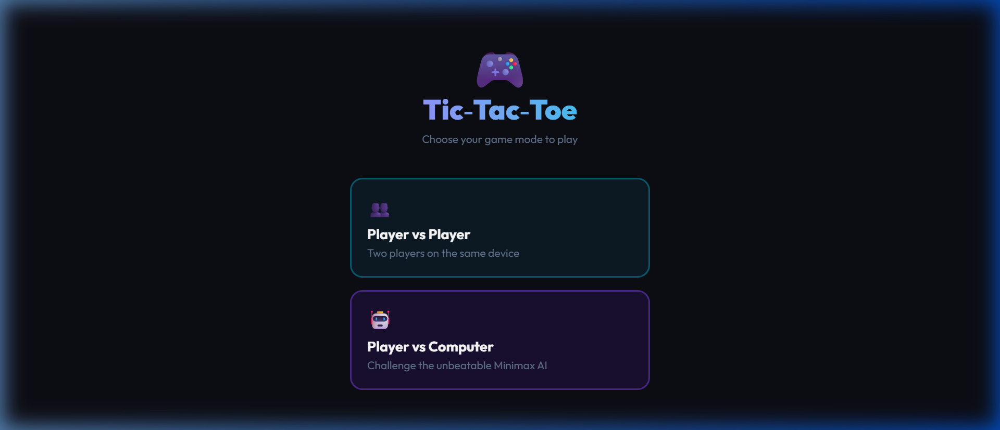

# 🎮 Tic-Tac-Toe

A beautifully designed Tic-Tac-Toe game built with **React 19 + Vite + Tailwind CSS**. Play against a friend on the same device, or challenge an **unbeatable Minimax AI**.

---

## 🌐 Live Demo

> **[Click here to view the live site →](https://6abaa81a88e3cc1472a675f0--splendid-narwhal-682ebe.netlify.app/)**

---

## 📸 Screenshot



---

## ✨ Features

- **Two Game Modes**
  - 👥 **Player vs Player** — Two humans on the same device
  - 🤖 **Player vs Computer** — Face a perfectly-playing Minimax AI
- **Minimax AI** — Evaluates every possible game state; truly unbeatable
- **Score Tracking** — X wins, O wins, and Draws tracked across rounds
- **Winning Line Highlight** — Winning cells glow with violet accent
- **Result Banner** — Instant feedback with Play Again / Change Mode buttons
- **Dark Neon UI** — Deep dark background with cyan and violet glowing accents
- **Fully Responsive** — Works great on mobile, tablet, and desktop

---

## 🛠️ Tech Stack

| Technology | Purpose |
|---|---|
| React 19 | Component-based UI & state management |
| Vite 8 | Lightning-fast dev server & bundler |
| Tailwind CSS 4 | Utility-first styling |
| JavaScript (ES6+) | Minimax algorithm & game logic |

---

## 🚀 Getting Started

### Prerequisites
- [Node.js](https://nodejs.org/) v18 or higher

### Installation & Development

```bash
# Clone the repository
git clone <repository-url>
cd TicTacToe

# Install dependencies
npm install

# Start the dev server
npm run dev
```

Then open **http://localhost:5173** in your browser.

```bash
npm run build      # Build for production
npm run preview    # Preview production build
npm run lint       # Run linter
```

---

## 📁 Project Structure

```
TicTacToe/
├── src/
│   ├── App.jsx       ← Full game: Minimax AI, Cell, ScoreCard, game logic
│   ├── App.css       ← Custom animations (fade-up, cell-pop, cell-win)
│   ├── index.css     ← Tailwind base imports
│   └── main.jsx      ← React entry point
├── index.html
├── vite.config.js
└── package.json
```

---

## 🧠 How the Minimax AI Works

The AI uses the **Minimax algorithm** — it simulates all possible future moves, assigns scores (+10 AI win, -10 player win, 0 draw), and always picks the optimal move. A depth penalty makes it prefer winning sooner.

> The AI cannot be beaten — the best outcome for the human player is a draw.

---

## 🎮 Game Rules

- Player X goes first in both modes
- In Player vs Computer mode, the computer plays as O
- Win by placing three marks in a row, column, or diagonal
- If the board fills with no winner, the round ends in a draw

---

## 📄 License

This project is available for educational and personal use.

---

<p align="center">Built with 🎮 React · Vite · Tailwind CSS · © 2026</p>
